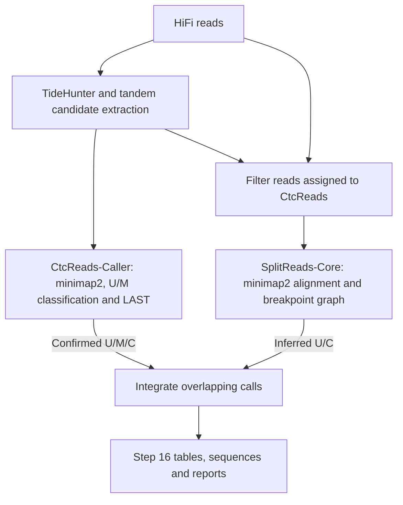

<p align="center">
  
</p>

# CircleSeeker

[](https://github.com/YaoxinBio/CircleSeeker)
[](https://github.com/YaoxinBio/CircleSeeker/actions/workflows/ci.yml)
[](https://www.python.org/)
[](LICENSE)

CircleSeeker reconstructs and classifies extrachromosomal circular DNA (eccDNA) from PacBio HiFi reads. It is the analysis software developed for Multi-Modal Circle-seq (MMC-seq). [Published study and software citation](#citation)

> The current release is [CircleSeeker v1.6.2](https://github.com/YaoxinBio/CircleSeeker/releases/tag/v1.6.2) (2026-11-21), a bug-fix release for pandas 3 compatibility. See the [changelog](CHANGELOG.md) for details.

## eccDNA Classification

CircleSeeker identifies and classifies eccDNA into three categories:

| Type | Full Name | Description |
|------|-----------|-------------|
| **UeccDNA** | Unique eccDNA | Derived from a single genomic locus |
| **MeccDNA** | Multiple eccDNA | One eccDNA sequence matches several candidate genomic loci. Its source cannot be resolved to a unique locus. |
| **CeccDNA** | Chimeric eccDNA | Formed by fusion of segments from different genomic locations |

## Installation

### Quick Install (Recommended)

```bash
# Clone the tagged release
git clone --branch v1.6.2 --depth 1 https://github.com/YaoxinBio/CircleSeeker.git
cd CircleSeeker

# Create and activate environment
conda env create -f environment.yml
conda activate circleseeker

# Install CircleSeeker
python -m pip install .

# Verify installation
circleseeker --version
```

To reproduce an analysis, record the Git commit and dependency versions alongside the results.

### Install from Bioconda

Bioconda provides CircleSeeker v1.6.1. The command below includes the NetworkX minimum used by the tagged implementation. [Bioconda package](https://bioconda.github.io/recipes/circleseeker/README.html)

```bash
conda create -n circleseeker -c conda-forge -c bioconda circleseeker=1.6.1 "networkx>=3.2"
conda activate circleseeker
circleseeker --version
```

### Manual Installation

If you prefer to install dependencies manually:

```bash
# 1. Create environment with Python
conda create -n circleseeker python=3.10
conda activate circleseeker

# 2. Core Python packages (conda-forge)
conda install -c conda-forge -y \
  pip biopython pandas numpy tqdm pyyaml \
  click "networkx>=3.2" intervaltree packaging \
  matplotlib python-graphviz pysam

# 3. Bioinformatics tools (bioconda)
conda install -c bioconda -c conda-forge -y \
  minimap2 samtools tidehunter cd-hit last \
  bedtools pybedtools

# 4. Install CircleSeeker
cd CircleSeeker
python -m pip install .
```

> **Note**: CircleSeeker includes SplitReads-Core, a built-in inference module inspired by [CReSIL](https://github.com/Peppermint-Lab/CReSIL) and optimized for HiFi long reads. The caller invokes the external `minimap2` executable for alignment.

## Quick Start

```bash
# Basic usage
circleseeker -i reads.fasta -r reference.fa -o output_dir

# With common options
circleseeker \
    -i sample.hifi.fasta \
    -r hg38.fa \
    -o results \
    -p sample_name \
    -t 16

# High-performance mode (requires sufficient /dev/shm space)
circleseeker \
    -i sample.hifi.fasta \
    -r hg38.fa \
    -o results \
    -t 32 \
    --turbo
```

## Usage

### Required Arguments

- `-i, --input PATH` - Input HiFi reads (FASTA format)
- `-r, --reference PATH` - Reference genome (FASTA format)

### Optional Arguments

- `-o, --output PATH` - Output directory (default: circleseeker_output)
- `-p, --prefix TEXT` - Output file prefix (default: sample)
- `-t, --threads INT` - Number of threads (default: 8)
- `-c, --config PATH` - Configuration file (YAML format)
- `-v, --verbose` - Increase verbosity (-v for INFO, -vv for DEBUG)
- `-h, --help` - Show help message
- `--keep-tmp` - Keep temporary files
- `--fast-align` - Use faster LAST alignment settings for CeccDNA detection
- `--turbo` - Enable turbo mode (use RAM-backed `/dev/shm` for faster I/O)

## Pipeline Overview

CircleSeeker implements a 16-step analysis pipeline organized into 5 phases, driven by two evidence-based callers:

- **CtcReads**: Reads containing **Ctc** (**C**oncatemeric **t**andem **c**opies) signals
- **CtcReads-Caller** (Steps 4–9): Produces **Confirmed** U/M/C eccDNA from CtcReads evidence
- **SplitReads-Caller** (Steps 10–13): Produces **Inferred** eccDNA from split-read/junction evidence

### Architecture



- **Preprocessing** (Steps 1-3): Dependency checks, tandem repeat detection, circular candidate extraction
- **CtcReads-Caller** (Steps 4-9): Alignment, U/M/C classification, deduplication — producing **Confirmed** eccDNA
- **SplitReads-Caller** (Steps 10-13): Read filtering, split-read inference — producing **Inferred** eccDNA
- **Integration** (Steps 14-15): Merges results and generates summary report
- **Packaging** (Step 16): Organizes final output directory

### Phase 1: Preprocessing (Steps 1-3)

| Step | Module | Description |
|------|--------|-------------|
| 1 | check_dependencies | Validate required tools and dependencies |
| 2 | tidehunter | Detect tandem repeats in HiFi reads |
| 3 | tandem_to_ring | Convert tandem repeats to circular candidates |

### Phase 2: CtcReads-Caller (Steps 4-9)

| Step | Module | Description |
|------|--------|-------------|
| 4 | run_alignment | Map candidates to reference genome (minimap2) |
| 5 | um_classify | Classify eccDNA as Unique (U) or Multiple (M) origin |
| 6 | cecc_build | Identify Chimeric (C) eccDNA using LAST |
| 7 | umc_process | Process and cluster U/M/C types |
| 8 | cd_hit | Remove redundancy (99% identity threshold) |
| 9 | ecc_dedup | Deduplicate and standardize coordinates |

### Phase 3: SplitReads-Caller (Steps 10-13)

| Step | Module | Description |
|------|--------|-------------|
| 10 | read_filter | Filter reads for inference (exclude CtcReads) |
| 11 | minimap2 | Prepare reference index |
| 12 | ecc_inference | Detect eccDNA using SplitReads-Core (built-in) |
| 13 | curate_inferred_ecc | Curate inferred eccDNA |

### Phase 4: Integration (Steps 14-15)

| Step | Module | Description |
|------|--------|-------------|
| 14 | ecc_unify | Merge confirmed and inferred results |
| 15 | ecc_summary | Generate statistics and summaries |

### Phase 5: Packaging (Step 16)

| Step | Module | Description |
|------|--------|-------------|
| 16 | ecc_packager | Package final outputs |

## Output Files

For `-o results -p sample`, Step 16 writes these files directly in `results/`. Use `sample_eccDNA_summary.csv` as the starting point for analysis.

| File or directory | Contents |
| --- | --- |
| `sample_eccDNA_summary.csv` | One row per eccDNA with its class, evidence state, location, length and support |
| `sample_eccDNA_regions.csv` | Source locus for Uecc, alternative loci for Mecc, ordered segments for Cecc |
| `sample_eccDNA_reads.csv` | Individual supporting reads from the Confirmed branch |
| `sample_eccDNA_all.fasta` | Available sequences from both evidence branches |
| `UeccDNA/`, `MeccDNA/`, `CeccDNA/` | Per-type BED and FASTA files, plus a Cecc junction BEDPE when segments are present |
| `sample_report.html`, `sample_summary.txt` | Reports copied from the summary step |

Join the CSVs on `eccDNA_id` (for example `UeccDNA0001`). Use `read_count` for total read support. When a Confirmed call also has split-read support, `inferred_reads` counts the reads added during integration. The built-in caller gives standalone Inferred calls a fixed `confidence` of `0.95` for compatibility. This value cannot be interpreted as a 95% probability that an individual call exists.

For all column names, coordinate conventions, FASTA headers and intermediate files, see the [English output reference](docs/Output_Format_Reference_en.md) or [中文输出格式参考](docs/Output_Format_Reference.md).

## Configuration

Create a custom configuration file in YAML format:

```yaml
# Basic settings
performance:
  threads: 16

# Tool-specific parameters
tools:
  tidehunter:
    k: 16
    w: 1
    p: 100
    P: 2000000
    e: 0.1
    f: 2

  alignment:
    min_identity: 99.0           # Base identity threshold for Step 4 (%)

  minimap2_align:  # For candidate alignment (Step 4)
    preset: "map-hifi"
    max_target_seqs: 5
    additional_args: ""
    # Identity filtering with length-based compensation (HiFi optimized)
    identity_decay_per_10kb: 0.5 # Identity decay per 10kb of sequence length (%)
    min_identity_floor: 97.0     # Minimum identity floor (%)

  minimap2:  # For read mapping (Step 11)
    preset: "map-hifi"
    additional_args: ""
```

For a complete list of configuration options, see the [Configuration Reference](docs/Configuration_Reference.md).

## System Requirements

- **Operating System**: Linux or macOS
- **Python**: ≥3.9
- **Memory**: Minimum 16GB (32GB recommended)
- **Storage**: ~50GB free space
- **CPU**: 8+ cores recommended

## Dependencies

### Python Packages

| Package | Version | Description |
|---------|---------|-------------|
| pandas | ≥2.0 | Data manipulation |
| numpy | ≥1.23 | Numerical computing |
| biopython | ≥1.81 | Sequence handling |
| pysam | ≥0.22 | BAM/SAM processing |
| networkx | ≥3.2 | Graph algorithms |
| intervaltree | ≥3.1 | Interval operations |
| click | ≥8.1 | CLI framework |
| pyyaml | ≥6.0 | Configuration parsing |
| packaging | ≥23.0 | Version parsing utilities |

### External Tools (Required)

| Tool | Version | Description |
|------|---------|-------------|
| TideHunter | ≥1.5.0 | Tandem repeat detection |
| minimap2 | ≥2.24 | Sequence alignment and read mapping |
| samtools | ≥1.17 | BAM file processing |
| CD-HIT | ≥4.8.1 | Sequence clustering (cd-hit-est) |
| LAST | ≥1250 | High-accuracy CeccDNA detection (lastal, lastdb, last-split) |
| bedtools | ≥2.30 | Genomic interval operations (required by pybedtools) |

### Additional Python Packages

| Package | Description |
|---------|-------------|
| pybedtools | Python wrapper for bedtools |

### Built-in Modules

| Module | Description |
|--------|-------------|
| CtcReads-Core | TideHunter-based confirmed eccDNA detection |
| SplitReads-Core | Built-in split-read inference inspired by [CReSIL](https://github.com/Peppermint-Lab/CReSIL), optimized for HiFi |

## Troubleshooting

### Resume Interrupted Run

```bash
# Resume from last checkpoint
circleseeker -i reads.fa -r ref.fa -o previous_output_dir
```

### Check Installation

```bash
# Verify CircleSeeker version
circleseeker --version

# Test with minimal data
circleseeker -i test.fa -r ref.fa -o test_output
```

### Common Issues

**FASTQ Input**: CircleSeeker requires FASTA format. Convert FASTQ first:
```bash
seqtk seq -A reads.fastq > reads.fasta
```

**Running in Background**: Use `nohup` instead of `&` to avoid multiprocessing issues:
```bash
# Recommended
nohup circleseeker -i input.fa -r ref.fa -o output -t 16 > run.log 2>&1 &

# Or use screen/tmux
screen -S circleseeker
circleseeker -i input.fa -r ref.fa -o output -t 16
```

**Out of Memory**: Reduce thread count or increase available memory
```bash
circleseeker -i input.fa -r ref.fa -t 4
```

**Missing Tools**: Install via conda
```bash
conda install -c bioconda -c conda-forge \
  tidehunter minimap2 samtools cd-hit last bedtools pybedtools
```

## Documentation

| English | 中文 |
| --- | --- |
| [Command-line reference](docs/CLI_Reference_en.md) | [命令行参考](docs/CLI_Reference.md) |
| [Output formats](docs/Output_Format_Reference_en.md) | [输出格式](docs/Output_Format_Reference.md) |
| [Configuration](docs/Configuration_Reference_en.md) | [配置参考](docs/Configuration_Reference.md) |
| [Pipeline modules](docs/Pipeline_Modules_en.md) | [流程模块](docs/Pipeline_Modules.md) |
| [U/M/C classification](docs/UMC_Classification_Model_en.md) | [U/M/C 分类模型](docs/UMC_Classification_Model.md) |
| [SplitReads-Core algorithm](docs/SplitReads_Core_Algorithm_en.md) | [SplitReads-Core 算法](docs/SplitReads_Core_Algorithm.md) |
| [Temporary directory](docs/Runtime_Tmp_Dir_en.md) | [临时目录](docs/Runtime_Tmp_Dir.md) |
| [U/M/C classification tests](docs/Validation_Methodology_en.md) | [U/M/C 分类验证](docs/Validation_Methodology.md) |

## Citation

If you use CircleSeeker, cite the MMC-seq paper and record the software version used in your analysis.

- Zhang, Y., You, M., Zhou, C. et al. MMC-seq enables efficient long-read eccDNA profiling from low-input samples. *Nature Communications* (2026). [doi:10.1038/s41467-026-79221-1](https://doi.org/10.1038/s41467-026-79221-1)
- Zhang, Y. & Yu, L. X. *CircleSeeker* (v1.6.1). Zenodo (2026). [doi:10.5281/zenodo.22718199](https://doi.org/10.5281/zenodo.22718199)

The paper reports CircleSeeker v1.6.1 for the primary libraries and all 27 benchmark scenarios. The simulator, evaluator and result tables are archived as CircleSeeker-benchmark v1.1.0. [Benchmark release](https://github.com/YaoxinBio/CircleSeeker-benchmark/releases/tag/v1.1.0) · [Benchmark archive](https://doi.org/10.5281/zenodo.22791547)

If you used a development checkout, record its Git commit. [Machine-readable citation](CITATION.cff) · [Release provenance](PROVENANCE.md)

## License

CircleSeeker is dual-licensed: GNU GPL v3.0 (see [LICENSE](LICENSE)) or a commercial license (see [COMMERCIAL_LICENSE.md](COMMERCIAL_LICENSE.md)).

## Contact

- Maintainer: Yaoxin Zhang (yxzhang@ncgr.ac.cn), [YaoxinBio](https://github.com/YaoxinBio)
- Bugs and support: [GitHub issues](https://github.com/YaoxinBio/CircleSeeker/issues)
- Original authors: Yaoxin Zhang and Leo Xinqi Yu (see [PROVENANCE.md](PROVENANCE.md)).

## Acknowledgments

We thank the developers of TideHunter, LAST, bedtools, and other integrated tools.
